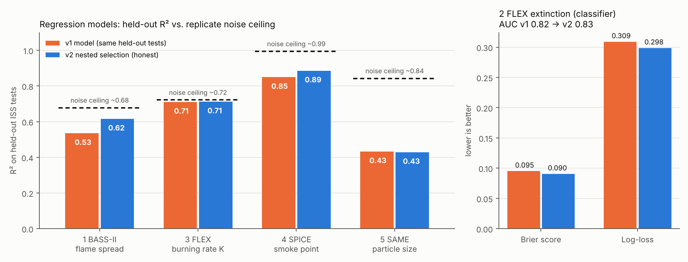

<h1 align="center">Ignis μ — AI Fire-Safety Insights from NASA Microgravity Combustion Data</h1>

<p align="center">
  <strong>850 real NASA experiments. Five trained models. Every number traceable to its NASA source.</strong>
</p>

<p align="center">
  <a href="#overview">Overview</a> •
  <a href="#my-role">My Role</a> •
  <a href="#features">Features</a> •
  <a href="#nasa-data">NASA Data</a> •
  <a href="#models">Models</a> •
  <a href="#architecture">Architecture</a> •
  <a href="#quick-start">Quick Start</a> •
  <a href="#project-structure">Structure</a>
</p>

---

## Overview

**Ignis μ** is Team **AgniShikha**'s project for the **NASA Space Apps Challenge 2026** (Dhaka), challenge **"Flame in Freefall: AI-Powered Fire Safety Insights from Microgravity Combustion Data"**.

In microgravity, fire does not rise. It burns as a sphere, can survive at lower oxygen, and does not follow the rules we learn on Earth. NASA has run hundreds of fire experiments on the International Space Station and on unmanned Cygnus vehicles. That knowledge is spread across separate investigations, file formats and papers.

Ignis μ brings those experiments together. You give it a condition: oxygen level, pressure, airflow and material. It answers with:

- how fast a fire will spread,
- whether a flame will go out,
- how sooty or smoky it will be,
- how large the smoke particles will be.

Every answer comes with an error band, the NASA evidence behind it, and an honest warning when NASA never tested that condition.

## My Role

I'm the **Data Science Lead** on Team AgniShikha.

**Data.** I built the project's dataset from NASA's Physical Sciences Informatics (PSI) repository.
- I found the files that hold the measured results, not just the test settings.
- I verified every extract byte-for-byte against NASA's copy.
- I cleaned and documented ten sources into one 850-row table.

**Models.** I trained and validated the five machine-learning models in `models/`.
- Each model is chosen with **nested grouped cross-validation**: 8 model families are tuned in an inner loop, and the whole selection procedure is scored on ISS tests it never saw.
- Each model is checked against a simple baseline and a replicate-based noise ceiling.

**Interface.** I wrote the single `predict()` interface that the backend and dashboard call.

The dashboard UI in `agnishikha-ui/` was built by our UI & Software Lead, **Tawhid Bin Omar**.

This repo is my copy of the project, kept here alongside my other work.

---

## Features

| Category | Details |
|---|---|
| **Verified NASA dataset** | 850 rows from 9 ISS/Cygnus investigations (798 microgravity runs) plus 52 rows of 1g ground reference. Every extract was checked against NASA's file, and 734 field-level checks found 0 errors |
| **Five trained models** | Flame spread, flame extinction, droplet burning rate, smoke point and smoke particle size, all trained on NASA ISS data |
| **Honest validation** | Grouped cross-validation holds out whole test series or sessions, and every model is compared against a baseline |
| **Explainability** | Exact Shapley values for every prediction: how much each input pushed the answer up or down |
| **Domain check** | Warns when an input is outside what NASA tested, including per-fuel and per-material ranges and nearest-experiment distance |
| **Traceability** | Every prediction carries `value_type`, the NASA source and the model's validation scores |
| **Mission-control dashboard** | Next.js dashboard with a microgravity flame visualizer, telemetry, risk matrix, explainability and crew protocols |
| **Beginner notebook** | A step-by-step notebook (with Bangla explanations) that rebuilds the flame-spread model from scratch |

---

## NASA Data

All source data is public domain (**CC0-1.0**) from [NASA Physical Sciences Informatics](https://psi.nasa.gov).

| Investigation | PSI record | What was measured | Rows used |
|---|---|---|---|
| **FLEX** — Flame Extinguishment Experiment | [PSI-69](https://psi.nasa.gov/physci/repo/data/investigations/PSI-69) · DOI 10.60555/mbq8-0451 | Droplet flame extinction, burning rate | 274 |
| **SPICE** — Smoke Point In Co-flow Experiment | [PSI-107](https://psi.nasa.gov/physci/repo/data/investigations/PSI-107) · DOI 10.60555/9kbh-e962 | Smoke point of gas-jet flames | 55 |
| **SAME / SAME-R** — Smoke Aerosol Measurement | [PSI-102](https://psi.nasa.gov/physci/repo/data/investigations/PSI-102), [PSI-101](https://psi.nasa.gov/physci/repo/data/investigations/PSI-101) | Smoke particle size and concentration | 154 |
| **BASS** — Burning and Suppression of Solids | [PSI-26](https://psi.nasa.gov/physci/repo/data/investigations/PSI-26) | Burn outcome and crew observations | 121 |
| **BASS-II** | [PSI-25](https://psi.nasa.gov/physci/repo/data/investigations/PSI-25) + Link et al. 2018, *Sci. Rep.* 8:120 | Flame spread over PMMA rods, gas response | 181 |
| **Saffire I–III** — Spacecraft Fire Experiment | [PSI-98](https://psi.nasa.gov/physci/repo/data/investigations/PSI-98), [PSI-99](https://psi.nasa.gov/physci/repo/data/investigations/PSI-99), [PSI-100](https://psi.nasa.gov/physci/repo/data/investigations/PSI-100) | Large-scale flame spread, with a 1g comparison | 13 |
| **WSTF 1g reference** | Hirsch et al. 2011, NTRS 20110008636 | Maximum oxygen concentration on Earth | 52 (comparison only) |

**A finding worth seeing:** in Saffire-II, silicone burned completely in 1g but **did not spread at all in microgravity**. Earth-based fire rules do not transfer directly to space.

Full documentation is in `data/README_dataset_v1.0.md` and the workbook `data/processed/Ignis_mu_NASA_dataset_v1.0.xlsx`. Start with its *Data_Map* sheet.

---

## Models

All scores come from **nested grouped cross-validation**. Whole ISS tests or sessions are held out, and all tuning and model choice happens without them. Full method: [models/MODEL_SELECTION_v2.md](models/MODEL_SELECTION_v2.md).

| # | Model | Question | Score (v2) | v1 on same splits | Baseline |
|---|---|---|---|---|---|
| 1 | `bass2_flame_spread` | How fast does flame spread over a PMMA rod? | R² **0.62** | R² 0.53 | R² −0.11 |
| 2 | `flex_extinction` | Will a fuel-droplet flame go out before the fuel is used up? | ROC-AUC **0.83**, Brier **0.090** | AUC 0.82, Brier 0.095 | AUC 0.50, Brier 0.114 |
| 3 | `flex_burning_rate` | How fast does the droplet burn? | R² **0.71**, MAE **0.045** | R² 0.71, MAE 0.048 | R² −0.01 |
| 4 | `spice_smoke_point` | How sooty is a gas flame? | R² **0.89**, MAE **4.4 mm** | R² 0.85, MAE 5.7 mm | R² −0.14 |
| 5 | `same_particle_size` | How large are smoke particles from an overheated material? | R² 0.43 | R² 0.43 | R² −0.07 |

How I chose the models:

- **Nested selection.** v1 reported the same CV score it used to pick the winner, which flatters the winner. v2 scores the whole procedure on tests that played no part in the choice.
- **One rule for all five models.** I compared four selection procedures and used the one with the best mean rank across all five datasets: average the top-3 tuned families, and fall back to the physics-form model (power law or logistic) outside the tested domain.
- **Physics stays in.** Power laws and log targets kept winning. SPICE recovers the published scaling of Dotson et al. (2011): smoke-point length ∝ burner diameter^−0.76 × coflow velocity^0.41.
- **Noise ceiling.** Near-identical runs from different ISS tests disagree. That limits the best possible R² to about 0.68 for flame spread and 0.72 for burning rate, and both models are now close to it.

<p align="center">
  
</p>

---

## Architecture

```
 NASA PSI repository (CC0)                         ESP32 sensor rig (O2, pressure, airflow)
          |                                                     |
          v                                                     v
 data/scripts  ->  verified extracts  ->  unified master table (850 rows)
                                                 |
                       +-------------------------+--------------------------+
                       v                                                    v
          models/ (5 trained models)                          evidence retrieval
          predict(model_name, **inputs)                       (NASA record behind each answer)
                       |                                                    |
                       +----------------------> FastAPI <-------------------+
                                                   |
                                                   v
                                 agnishikha-ui (Next.js dashboard)
```

---

## Tech Stack

| Layer | Technology |
|---|---|
| **Data pipeline** | Python 3, pandas, NumPy, openpyxl |
| **Machine learning** | scikit-learn 1.9 (Extra Trees, linear and power-law regression), exact Shapley explanations, joblib |
| **Backend (planned)** | FastAPI calling `models/ignis_models.py` |
| **Frontend** | Next.js 16 (App Router), React 19, TypeScript, Tailwind CSS 4, lucide-react |
| **Hardware** | ESP32 with O2, pressure, temperature and airflow sensors |
| **Data source** | NASA Physical Sciences Informatics (PSI) |

---

## Quick Start

### 1. Clone

```bash
git clone https://github.com/prachyabiswas/NASA-Space-Apps-2026.git
cd NASA-Space-Apps-2026
```

### 2. Run the models

```bash
cd models
pip install pandas numpy scikit-learn==1.9.1 joblib matplotlib openpyxl
python test_predict.py
```

```python
from ignis_models import predict
predict("flex_extinction", fuel="Methanol", pressure_kpa=101.3, o2_pct=18, co2_pct=0, he_pct=0, d0_mm=3.0)
predict("spice_smoke_point", fuel="Propylene", burner_diameter_mm=1.6, coflow_air_velocity_cm_s=30)
```

### 3. Run the dashboard

```bash
cd agnishikha-ui
npm install
npm run dev        # http://localhost:3000
```

### 4. Rebuild the dataset from NASA's files

```bash
cd data
python scripts/build_flex.py raw_from_NASA/PSI-69_Experimental_table_FLEX.csv processed
python scripts/verify_all.py raw_from_NASA processed
```

---

## Project Structure

```
NASA-Space-Apps-2026/
├── agnishikha-ui/            # Next.js mission-control dashboard (Tawhid Bin Omar)
├── data/
│   ├── processed/            # Clean datasets, unified master table, Excel workbook
│   ├── raw_from_NASA/        # Verbatim NASA PSI extracts (SHA-256 verified)
│   ├── bass2_and_wstf/       # BASS-II flame-spread and gas data, WSTF 1g reference
│   ├── scripts/              # Build and verification scripts
│   └── README_dataset_v1.0.md
├── models/
│   ├── ignis_models.py       # predict() entry point, Shapley, domain checks, physics fallback
│   ├── ml_selection.py       # Model families, tuning grids, nested grouped CV
│   ├── train_v2.py           # Trains all five models
│   ├── *.joblib              # Trained models
│   ├── *_v2_nested_cv.csv    # Every family and selection procedure, scored on held-out tests
│   ├── MODEL_SELECTION_v2.md # How the models were selected, v1 vs v2
│   ├── v1_archive/           # v1 models kept for comparison
│   └── README.md             # Model cards
├── notebooks/                # Beginner notebook: build the flame-spread model step by step
└── docs/                     # Figures, ML design notes, abstract draft, verification guide
```

---

## Status and Limits

- **Dashboard:** it still runs on a client-side placeholder model. Connecting it to the trained models through `/predict/{model_name}` is in progress.
- **Data size:** 52–256 rows per model. The scores are honest held-out numbers, but the error bands are wide (95 % CIs are in `models/model_summary.json`). For flame spread and burning rate the remaining error is mostly run-to-run noise, so more ISS experiments, not more modelling, would improve them.
- **1g data:** the WSTF ground reference is a comparison layer and is never used to train microgravity models.
- **Missing outcomes:** the FLEX-2 and Cool Flames Investigation tables list test conditions only, so they are not modelled.

---

## Team AgniShikha

| Member | Role |
|---|---|
| Apurbo Kumar | Team Lead & Project Manager |
| Purno | Physics & Technical Lead |
| Mahib Al Mamun | Hardware & Embedded Lead |
| Tawhid Bin Omar | UI & Software Lead |
| Prachya Biswas | Data Science Lead |
| Samyo Pramanik | AI Lead |

---

## License

NASA source data is public domain (CC0-1.0) from NASA Physical Sciences Informatics. Code was written by Team AgniShikha for the NASA Space Apps Challenge 2026.

---

<p align="center">
  Built by Team AgniShikha for NASA Space Apps Challenge 2026 — Data Science & ML: <a href="https://github.com/prachyabiswas">Prachya Biswas</a> · UI: <a href="https://github.com/Dumbo-programmer">Tawhid Bin Omar</a>
</p>
