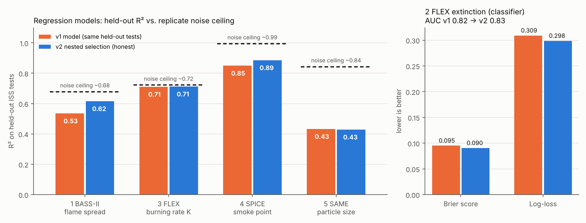
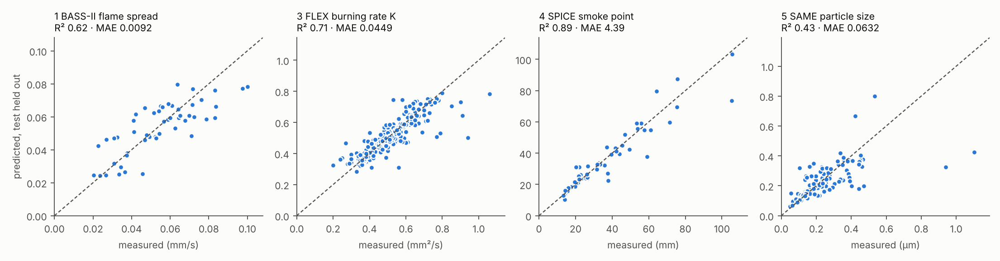

# Model Selection v2: nested, grouped and honest

**Author:** Prachya Biswas (Data Science Lead, Team AgniShikha)

This note explains how I rebuilt model selection for the five Ignis μ models after mentor feedback that selection should be stronger and performance better.

## 1. What was wrong with v1

| Problem in v1 | Why it matters |
|---|---|
| The model was chosen by its cross-validation score, and the same score was then reported. | The reported score is optimistic. It already helped to pick the winner (selection bias). |
| Each candidate ran with one hand-picked setting. | No hyper-parameter tuning, so some families never got a fair chance. |
| Only 3–4 candidates per model. | Kernel methods and Gaussian processes were never tried. |
| AUC alone chose the classifier. | Good ranking can come with bad probabilities. A risk tool needs honest probabilities. |

When I re-scored the v1 models on the same held-out splits used for v2, two v1 headline numbers fell: FLEX extinction AUC went from 0.84 to 0.82, and SAME R² from 0.50 to 0.43.

## 2. The v2 procedure

```
for each outer fold (whole ISS tests / sessions held out)        <- honest score
    for each of 8 model families (7 for the classifier)
        tune hyper-parameters with grouped inner CV                <- selection happens here only
    choose a model with the selection procedure
    predict the held-out tests
```

**Families.** Ridge, Ridge with interaction terms, k-nearest neighbours, support-vector regression/classification (RBF), Gaussian process with one length scale per input (ARD), random forest, extra trees and gradient boosting.
- For the flame-spread and burning-rate models, *fit on log(target)* is also tuned. This lets a power law win if the data prefers it.

**Grouping.** Rows from the same ISS test series, session or run pair always stay on the same side of every split. This holds in both the inner and the outer loop.
- Outer loop: leave-one-test-out (BASS-II, SPICE) or GroupKFold(5) repeated 3 times (FLEX, SAME).
- Inner loop: leave-one-group-out for small sets, otherwise GroupKFold(5) repeated twice.

**Scoring rules.**
- Regression uses MAE.
- The classifier uses log-loss, a proper scoring rule, so a model with poorly calibrated probabilities cannot win.

**Four selection procedures were compared, all scored honestly in the outer loop:**

| Procedure | Idea |
|---|---|
| best inner score | take the family with the best tuned inner-CV score |
| 1-SE rule | take the simplest family within one paired standard error of the best |
| top-3 average | average the three best tuned families (an ensemble) |
| **top-3 average + physics-form fallback** | the ensemble inside the tested domain; outside it, the transparent physics-form model (log-linear power law, or logistic regression) |

**One procedure for all five models.** I did not pick a procedure per model, because five separate picks would bring the selection bias back. The procedure with the best mean rank across the five datasets was used everywhere.

| Procedure | BASS-II | FLEX ext. | FLEX K | SPICE | SAME | mean rank |
|---|---|---|---|---|---|---|
| best inner score | 1 | 4 | 3 | 4 | 3 | 3.0 |
| 1-SE rule | 3 | 3 | 4 | 3 | 4 | 3.4 |
| top-3 average | 4 | 2 | 2 | 2 | 1.5 | 2.3 |
| **top-3 + physics fallback** | 2 | **1** | **1** | **1** | 1.5 | **1.3** |

**Why the fallback exists.** In SPICE, the ensemble beat the power law in 7 of 11 held-out sessions. It failed badly in the two sessions that held almost all the data for one fuel-and-burner combination. Flexible models extrapolate poorly; physics power laws extrapolate gracefully.
- The fallback uses the same domain check the deployed model runs: tested ranges, per-fuel or per-material ranges, and nearest-run distance.
- In the CV it was applied only to held-out rows outside the *training* domain.
- SAME has no physics-form fallback. No established physical law links particle size to these inputs, and the log-linear model is weak there (R² ≈ 0.30). This rule was set after seeing the first fallback results, and I report it openly.

## 3. Results (every number from nested grouped CV)

| # | Model | Final model | v1 on same splits | **v2 nested** | 95 % CI (group bootstrap) | Noise ceiling |
|---|---|---|---|---|---|---|
| 1 | `bass2_flame_spread` | avg(Ridge-log, SVR, Ridge+interactions) + power-law fallback | R² 0.53, MAE 0.0094 | **R² 0.62, MAE 0.0092** | R² 0.33–0.73 | ~0.68 |
| 2 | `flex_extinction` | avg(Logistic+interactions, SVM, Extra trees) + logistic fallback | AUC 0.82, Brier 0.095, log-loss 0.309 | **AUC 0.83, Brier 0.090, log-loss 0.299** | AUC 0.73–0.91 | – |
| 3 | `flex_burning_rate` | avg(SVR, Gaussian process, Ridge) + linear fallback | R² 0.71, MAE 0.0476 | **R² 0.71, MAE 0.0449** | R² 0.60–0.82 | ~0.72 |
| 4 | `spice_smoke_point` | avg(Gaussian process, SVR, power law) + power-law fallback | R² 0.85, MAE 5.69 mm | **R² 0.89, MAE 4.39 mm** | R² 0.81–0.92 | ~0.99 |
| 5 | `same_particle_size` | avg(SVR, Extra trees, Random forest) | R² 0.43, MAE 0.0635 | R² 0.43, MAE 0.0632 | R² 0.29–0.61 | ~0.84 |



**Noise ceiling.** Pairs of runs from *different* ISS tests with almost identical inputs should give the same answer. Their disagreement is run-to-run noise that no model can explain.
- Noise variance ≈ mean((yᵢ − yⱼ)²)/2 over those pairs, and the best possible R² ≈ 1 − noise/total variance (`noise_ceiling.py`).
- This is approximate, because near-replicates are not perfect replicates.
- BASS-II and FLEX K are now close to their ceilings, so more modelling cannot add much there. Only more experiments can.
- SPICE and SAME still have room. For SAME the limits are the inputs: two campaigns used different instruments, and there are only five materials.



## 4. What I learned

1. **Report the score of the whole procedure, not of the winner.** Nested CV is the only way to do that.
2. **On 50–250 rows, the choice of family matters less than the uncertainty.** Most CIs overlap, so I compare on the same splits and show the CIs.
3. **Averaging good models beats picking one.** It removes the selection noise from small inner folds.
4. **Physics belongs in the model.** Power laws and log targets won repeatedly, and the physics fallback fixed the worst extrapolation errors.

## Files

| File | Content |
|---|---|
| `ml_selection.py` | families, grids, nested CV, selection procedures, metrics, bootstrap CI |
| `train_v2.py` | trains all five models (`python train_v2.py`; `--reuse` uses the cached nested CV in `artifacts/`) |
| `reports/*_v2_nested_cv.csv` | every family and procedure, scored in the outer loop |
| `reports/*_v2_final_selection.csv` | inner-CV ranking and tuned hyper-parameters of the final model |
| `reports/*_v2_oof.csv` | held-out prediction for every NASA row (v2 and v1) |
| `reports/v1_vs_v2.csv`, `reports/v2_procedure_ranks.csv`, `reports/noise_ceiling.json` | the tables above |
| `artifacts/archive/v1/` | the v1 models and scripts, kept for comparison |
